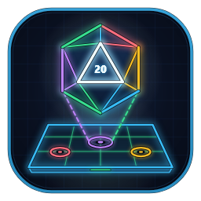

<p align="center">
  
</p>

<h1 align="center">DiceChaosDisplay</h1>

<p align="center">
  <strong>A native Windows DM Studio paired with a borderless Player TV Display—engineered specifically for playing D&amp;D and TTRPGs with real physical miniatures and real dice sitting on TV glass at locked 60 FPS.</strong>
</p>

<p align="center">
  <a href="https://github.com/dicechaos/DiceChaosDisplay/releases/latest"><strong>⬇ Download Latest Release (Windows x64)</strong></a>
  &nbsp;•&nbsp;
  <a href="FEATURES.md"><strong>Full Feature Reference</strong></a>
  &nbsp;•&nbsp;
  <a href="https://dicechaos.com"><strong>dicechaos.com</strong></a>
</p>

---

## Why DiceChaosDisplay?

Most virtual tabletops assume every player is staring at a laptop browser. **DiceChaosDisplay** is built from the ground up for **in-person tabletop play** on a flat-screen TV, custom gaming table, or projector:

- **100% Native, Offline & Zero-Subscription:** Local `.dicechaos` campaign files, images, `.uvtt` bundles, and animated videos—no browser stutter, no cloud accounts, and no internet needed on game night.
- **True 1-Inch Physical Miniature Scale:** Per-Monitor V2 High-DPI math ensures 1 tactical square equals **1.00 real physical inch (`25.4 mm`)** on the TV glass—calibrated via TV diagonal presets (`32"`–`65"`) or a live **On-TV 1-Inch Physical Ruler**.
- **Zero-Lag 4K / 8K & Video Battlemaps:** Asynchronous `2048×2048` frustum-culled GPU tiles + airspace-free looping `MP4` / `WEBM` video battlemaps rendered smoothly *underneath* grids, rings, AoEs, and Fog of War.
- **Universal VTT One-Step Import (`.dd2vtt` / `.uvtt` / `.df2vtt`):** Imports maps from Dungeondraft, Dungeon Alchemist, and Arkenforge with automatic grid calibration and optional DM-only wall/door guides.
- **Sub-Millisecond Feathered Fog of War & 1-Click Rooms:** Freehand Fog Brush, Box, and Polygon tools with soft feathered edges, plus pre-pped **1-Click Dungeon Room** badges (`LOCKED` / `OPEN`) for instant room reveals.
- **Under-Mini Glowing Rings & 5e Spell AoEs:** Clean glow-only condition/aura rings (`Concentrating`, `Bloodied`, `Blessed`, `Hexed`, `Poisoned`, `10ft`/`15ft`/`30ft` auras) designed to shine beneath real physical miniatures, alongside rotatable `Sphere`, `5e Cone`, `Cube`, and `Line` spell templates, a `5-5-5` / `5-10-5` / `Euclidean` ruler, `Alt+Click` sonar pings, secret DM-only pins, and a pre-staged **TV Handout Presenter**.
- **Smart Dual-Screen & Single-Monitor Prep:** Toggle the Player TV screen **ON / OFF** anytime (`F12`), stage maps privately before pushing (`Ctrl+Enter`), engage spoiler-safe **Blackout** (`B`), and prep safely on a single laptop screen via automatic **16:9 Floating Preview Mode**.

👉 See **[FEATURES.md](FEATURES.md)** for the complete breakdown of every tool and capability.

---

## Quick Download & First Run (Windows 10 / 11 x64)

1. Download **`DiceChaosDisplay-v1.0.0-win-x64.zip`** from the **[Releases](https://github.com/dicechaos/DiceChaosDisplay/releases)** page.
2. Right-click the `.zip` → **Extract All...** into any folder.
3. Run **`DiceChaosDisplay.exe`** (self-contained—no `.NET` runtime installation required!).
   > **Note on Windows SmartScreen:** Because this is an independent open-source desktop executable, Windows may show *"Windows protected your PC"* the very first time you launch it. Click **More info** → **Run anyway**.

---

## Essential Table Hotkeys (`F1` in-app opens the full Cheat-Sheet)

| Shortcut | Action |
| :--- | :--- |
| **`F12`** (or **`Esc`** on TV) | Toggle Player TV Screen **ON / OFF** |
| **`Ctrl + Enter`** | Push privately staged DM scene to Live TV |
| **`B`** | Toggle TV Blackout / Campaign Standby Splash |
| **`Middle-Drag`** or **`Space + Drag`** | Pan DM canvas from any tool (`Mouse Wheel` to zoom) |
| **`C`** / **Drag `✥ TV VIEW`** | Center or drag the TV viewport directly from any tool |
| **`2` / `3` / `4` / `5`** | Fog Brush / Fog Box / Fog Polygon / 1-Click Room Prep (`[` & `]` brush size, `Right-Drag` inverse fog) |
| **`6` / `7` / `8` / `9`** | 3×3 Visual Grid Matcher / Pencil / Ping / 5e Distance Ruler |
| **`A` / `T` / `N`** | 5e Spell AoE / Under-Mini Glow Ring / Secret DM Note Pin |
| **`Alt + Click`** | Sonar Ping on both DM & Player TV from any active tool |
| **`Ctrl + Z` / `Ctrl + Y`** | Unified Undo / Redo across Fog, Rooms, AoEs, Rings, Sketches, & Pins |
| **`Tab` / `F11`** | Focus Mode (collapse sidebars) / Fullscreen DM Studio |

---

## Building & Testing from Source

Requires the **[.NET 10.0 SDK](https://dotnet.microsoft.com/download/dotnet/10.0)** on Windows (`x64`):

```powershell
# Run the automated unit & 8K stress test suite
dotnet test Tests\DiceChaosDisplay.Tests.csproj

# Build & run Debug or Release
dotnet run --project DiceChaosDisplay.csproj -c Release

# Publish a self-contained portable Windows x64 folder
dotnet publish DiceChaosDisplay.csproj -c Release -r win-x64 --self-contained true -o publish\DiceChaosDisplay-win-x64
```

---

## Third-Party Notices & License

- **DiceChaosDisplay** is released under the **[MIT License](LICENSE)** — Copyright © 2026 **Gus / DiceChaos** ([dicechaos.com](https://dicechaos.com)).
- Uses **[SkiaSharp](https://github.com/mono/SkiaSharp)** (MIT License) for high-speed 2D alpha compositing and **[LibVLCSharp](https://code.videolan.org/videolan/LibVLCSharp) / [VideoLAN LibVLC](https://www.videolan.org/vlc/libvlc.html)** (LGPL-2.1, dynamically linked in `libvlc/`) for animated video battlemap decoding.
